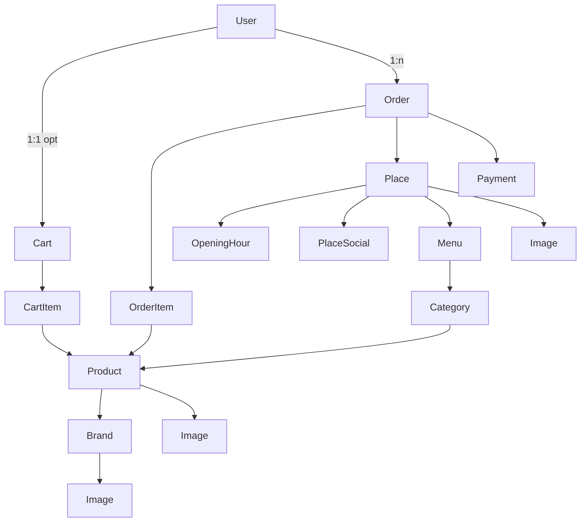

# Техническое задание

**Продукт:** цифровое меню заведения, личный кабинет гостя, онлайн-оплата, админка контента и заказов.  
**Репозиторий:** NestJS 12 + Prisma 7 (PostgreSQL) + REST (auth, каталог) + GraphQL (меню, корзина, заказы).  
**Валюта:** UAH.  
**Версия документа:** 1.0 · 3 октября 2026.

Легенда статуса: **[ЕСТЬ]** уже в коде (частично), **[ПЛАН]** проектируется, **[РЕКОМЕНДАЦИЯ]** не в схеме, предлагается этим ТЗ.

Онлайн-оплата обязательна и **с аккаунтом, и без**: гость с cookie-корзиной тоже оформляет заказ и платит. Доставку в v1 закладываем как тип получения, который заведение может выключить.

---

## 1. Назначение и границы

Система — бэкенд одного (или нескольких) заведений общественного питания.

Гость со смартфона открывает меню, видит фото и цены, собирает корзину (cookie без регистрации), оформляет заказ, **оплачивает онлайн**, следит за статусом по ссылке из письма или по секретному токену заказа. С аккаунтом то же плюс история в ЛК.

Администратор правит карточку заведения, часы, соцсети, фото, меню, разделы, блюда, цены, наличие, заказы.

**Не цель v1:** собственное приложение курьера, KDS-экран на кухню как отдельный продукт, склад партий, бухгалтерия, мультиарендность «SaaS на 100 ресторанов» (модель Place это допускает, но UX — одно-несколько своих заведений).

Фронтенд в этом репозитории **не входит**; ТЗ описывает контракт API, на который сядет веб/QR-меню.

---

## 2. Роли

| Роль         | Кто                                       | Может                                                                                     |
| ------------ | ----------------------------------------- | ----------------------------------------------------------------------------------------- |
| Аноним       | нет JWT, есть `sessionId` cookie          | меню, корзина, **checkout + онлайн-оплата**, статус заказа по `guestAccessToken` / письму |
| Пользователь | JWT `{ id }`, email                       | то же + ЛК и история всех своих заказов, профиль                                          |
| Админ        | JWT + `isAdmin = true` **[РЕКОМЕНДАЦИЯ]** | всё пользователя + CMS заведения, каталог, заказы, смена статусов, просмотр платежей      |

Сейчас write-роуты каталога открыты **любому JWT** — это дыра. В целевой модели мутации каталога и заведения — только админ.

Роли RBAC уровней manager/cook **не возвращаем**, пока не понадобится кухня. Достаточно флага `User.isAdmin`. Первый админ — seed или `ADMIN_EMAILS` в env.

---

## 3. Принципы API

- **REST:** регистрация, логин, verify, `GET /auth/me`, админский CRUD (проще формы, файлы, вебхуки оплаты).
- **GraphQL:** публичное меню одним деревом; корзина и заказы гостя. Нет корневых query `openingHours` / `images` / `cartItem` — только вложенность.
- **Нет GraphQL User** как зеркала Prisma. ЛК: REST `/auth/me` расширить или query `me` (id, email, name, emailVerified) без password.
- Деньги в ответах GraphQL — `Float` (2 знака); в БД — `Decimal(10,2)`.
- Идентификаторы — Int autoincrement (как сейчас). Slug — для URL меню и блюда.

---

## 4. База данных

PostgreSQL. Клиент Prisma 7 + `pg` adapter. Миграции на диске **отстают** от `schema.prisma` (Place/Menu/часы/соцсети/guest cart/`Image.placeId` ещё не в SQL) — до продакшена обязателен `prisma migrate dev`.

### 4.1. Диаграмма (целевая, включая оплату)



### 4.2. Справочники enum

**DayOfWeek** `[ЕСТЬ]`: MONDAY … SUNDAY. Один ряд часов на пару (place, день).

**SocialNetwork** `[ЕСТЬ]`: INSTAGRAM, FACEBOOK, TIKTOK. Не больше одной ссылки данного типа на заведение.

**OrderStatus** `[ЕСТЬ, уточнить смысл]`: сейчас `PENDING, COOKING, READY, SHIPPED, DELIVERED, CANCELLED`. Для заведения и оплаты целевой набор:

| Статус            | Смысл                                       |
| ----------------- | ------------------------------------------- |
| `PENDING_PAYMENT` | заказ создан, ждём оплату                   |
| `PAID`            | webhook подтвердил платёж                   |
| `CONFIRMED`       | кухня взяла в работу (или сразу после PAID) |
| `COOKING`         | готовится                                   |
| `READY`           | можно забирать / нести за стол              |
| `COMPLETED`       | закрыт (гость забрал / съел)                |
| `CANCELLED`       | отменён; если уже PAID — логика возврата    |
| `PAYMENT_FAILED`  | отказ шлюза / таймаут сессии оплаты         |

`SHIPPED` / `DELIVERED` оставить только если включена доставка; иначе не использовать.

**FulfillmentType** `[РЕКОМЕНДАЦИЯ]`: `DINE_IN` \| `TAKEAWAY` \| `DELIVERY`.

**PaymentStatus** `[РЕКОМЕНДАЦИЯ]`: `NEW` \| `PENDING` \| `SUCCEEDED` \| `FAILED` \| `EXPIRED` \| `REFUNDED`.

**PaymentProvider** `[РЕКОМЕНДАЦИЯ]`: `LIQPAY` (основной для UAH) с запасом под Fondy/Stripe.

### 4.3. User `[ЕСТЬ]` + расширения

| Поле                  | Тип         | Назначение                                                                                |
| --------------------- | ----------- | ----------------------------------------------------------------------------------------- |
| id                    | Int PK      |                                                                                           |
| email                 | unique      | логин                                                                                     |
| name                  | String      |                                                                                           |
| password              | hash bcrypt | никогда не в API                                                                          |
| emailVerified         | Boolean     |                                                                                           |
| metaData              | Json?       | сейчас пишется `{ token }` — **не использовать как источник истины**; гард JWT не сверяет |
| createdAt / updatedAt |             |                                                                                           |

**[РЕКОМЕНДАЦИЯ]:** `isAdmin Boolean @default(false)`, `phone String?`.  
**Не делать:** HistoryOrderUser (история = `Order`). Персональная скидка — не в v1 (явный отказ).

Инварианты: email нормализовать lowercase при записи. Пароль: min 8, 1 upper, 1 digit, 1 symbol (как DTO сейчас).

### 4.4. Place `[ЕСТЬ]`

Карточка заведения.

| Поле                                 | Смысл                                                  |
| ------------------------------------ | ------------------------------------------------------ |
| name, slug unique                    | URL `/p/:slug`                                         |
| wifiPassword?                        | гостевое меню может показывать; это не секрет аккаунта |
| description?                         |                                                        |
| address                              | обязателен                                             |
| addressUrl?                          | ссылка на карты                                        |
| phone                                | обязателен                                             |
| email?, website?                     |                                                        |
| openingHours, socials, menus, images | связи                                                  |

**[РЕКОМЕНДАЦИЯ]:** `timezone String @default("Europe/Kyiv")` — «сейчас открыто»; флаги `dineInEnabled`, `takeawayEnabled`, `deliveryEnabled`; `minOrderAmount Decimal?` для доставки.

Удаление Place каскадом сносит часы, соцсети, меню (и категории/блюда через Menu Cascade). В проде Place лучше soft-hide, не hard delete.

### 4.5. OpeningHour `[ЕСТЬ]`

| Поле                 | Смысл                                    |
| -------------------- | ---------------------------------------- |
| dayOfWeek            | enum                                     |
| openTime / closeTime | `String?` формат `HH:mm`, не Prisma Time |
| isClosed             | выходной; времена можно не заполнять     |
| placeId              | unique вместе с днём                     |

Инвариант: если `!isClosed`, оба времени обязательны; `closeTime < openTime` = через полночь (22:00–02:00).  
Сравнение «открыто сейчас»: минуты от полуночи + timezone Place.

### 4.6. PlaceSocial `[ЕСТЬ]`

`type` + `url` + unique (placeId, type). URL с https. От 0 до 3 ссылок.

### 4.7. Menu `[ЕСТЬ]`

«Кухня», «Бар», не список блюд. Блюдо = Product.

| Поле       | Смысл                 |
| ---------- | --------------------- |
| name, slug | unique в рамках place |
| isActive   | скрыть сезонное меню  |
| sortOrder  | порядок вкладок       |
| category[] | разделы               |

### 4.8. Category `[ЕСТЬ]`

Раздел («Салаты», «Пицца»). Unique `(menuId, slug)` — два меню могут оба иметь «Салаты». Это не «Цезарь vs Греческий» (то Product.title).

REST create уже требует `menuId`.

**[РЕКОМЕНДАЦИЯ]:** `sortOrder Int`.

### 4.9. Product `[ЕСТЬ]`

Блюдо/товар.

| Поле                             | Смысл                                                                                                                 |
| -------------------------------- | --------------------------------------------------------------------------------------------------------------------- |
| title, slug unique **глобально** | карточка `/dish/:slug`                                                                                                |
| description?                     |                                                                                                                       |
| price, discountPrice?            | Decimal 10,2; если discount задан и &lt; price — витрина показывает скидку                                            |
| stock                            | для кухни часто лишний; пока есть. **[РЕКОМЕНДАЦИЯ]** трактовать как «можно продать»; 0 + isActive=false = нет в меню |
| isActive                         | soft-delete / снять с витрины                                                                                         |
| categoryId?                      | для меню должен быть задан                                                                                            |
| brandId?                         | для ресторана опционален (напитки)                                                                                    |
| image[]                          | галерея                                                                                                               |

Инварианты витрины: в публичном API только `isActive=true` и (если используем stock) `stock > 0` **или** игнорируем stock для еды (решение админки: «не учитывать остаток»). **Рекомендация v1:** публичное меню фильтрует только `isActive`; stock не показываем гостю.

### 4.10. Brand `[ЕСТЬ]`

Справочник производителя. Не обязателен для блюд кухни. Админ может не заполнять.

### 4.11. Image `[ЕСТЬ]`

| Поле                          | Смысл                                               |
| ----------------------------- | --------------------------------------------------- |
| url                           | CDN/S3/публичный URL                                |
| alt?                          | a11y                                                |
| sortOrder                     | порядок галереи                                     |
| isPrimary                     | обложка; **в сервисе** ровно одна true на владельца |
| brandId / productId / placeId | XOR: ровно один FK                                  |

Хранение файлов v1: админ передаёт уже залитый `url` (Cloudinary/S3). Загрузка multipart **[ПЛАН]** `POST /admin/uploads` → url.

### 4.12. Cart / CartItem `[ЕСТЬ схема, нет сервиса]`

| Cart | userId? unique, sessionId? unique, item[] |
| CartItem | quantity ≥ 1, unique (cartId, productId) |

Инварианты:

- Ровно один якорь: либо userId, либо sessionId, не оба пустые; после логина merge → только userId, sessionId очистить.
- Нельзя две корзины на одного user.
- Добавление того же product увеличивает quantity.
- В корзину только isActive product.
- sessionId не отдавать в GraphQL (угон корзины). Cookie `HttpOnly`, `SameSite=Lax`, случайные 32+ байт.

**[РЕКОМЕНДАЦИЯ]:** `placeId` на Cart — не смешивать блюда разных заведений.

### 4.13. Order / OrderItem `[ЕСТЬ схема, нет сервиса]`

Сейчас: status, totalAmount, currency, notes, userId?, item[] со snapshot цены.

Целевые поля **[РЕКОМЕНДАЦИЯ]:**

| Поле             | Смысл                                                                                                                           |
| ---------------- | ------------------------------------------------------------------------------------------------------------------------------- |
| placeId          | чьё заведение                                                                                                                   |
| fulfillment      | DINE_IN / TAKEAWAY / DELIVERY                                                                                                   |
| tableNumber?     | зал                                                                                                                             |
| guestPhone       | контакт; для юзера можно копировать с профиля; **для гостя обязателен вместе с guestEmail**                                     |
| guestEmail       | чек и ссылка на заказ; у залогиненного = User.email                                                                             |
| guestAccessToken | случайная строка, отдать один раз при checkout; по ней читать/доплатить/отменить без JWT. Не светить в списках админки публично |
| scheduledAt?     | DateTime слот «ко времени»; проверить OpeningHour                                                                               |
| address?         | только DELIVERY                                                                                                                 |
| paidAt?          |                                                                                                                                 |

OrderItem: quantity, unitPrice, totalPrice, productId — **снимок**. Название блюда `title String` на позиции **[РЕКОМЕНДАЦИЯ]**, чтобы история не ломалась после переименования.

Пересчёт totalAmount = сумма totalPrice позиций (после оплаты не менять).

Каскад: удаление заказа удаляет позиции; Product не удалять hard, если есть OrderItem (Restrict).

### 4.14. Payment `[РЕКОМЕНДАЦИЯ, обязательно из-за онлайн-оплаты]`

Отдельная таблица, не Json в Order.

| Поле              | Смысл                                                             |
| ----------------- | ----------------------------------------------------------------- |
| id                |                                                                   |
| orderId           | unique 1:1 или 1:n попыток; v1 — несколько попыток, успешная одна |
| provider          | LIQPAY                                                            |
| providerPaymentId | id у шлюза                                                        |
| status            | PaymentStatus                                                     |
| amount, currency  | дубль суммы заказа                                                |
| rawPayload Json?  | тело webhook для аудита                                           |
| paidAt?           |                                                                   |
| createdAt         |                                                                   |

Инвариант: SUCCEEDED только после **проверенной** подписи webhook. Сумма webhook == order.totalAmount. Идемпотентность по providerPaymentId.

---

## 5. Логика гостя (пользователь)

### 5.1. Публичное меню

1. Открыть `place(slug)` → инфо, wifi, часы, соцсети, фото, активные меню.
2. Меню → разделы по sortOrder → блюда isActive, цена (price / discountPrice), галерея, brand опционально.
3. «Сейчас открыто» считать на бэке или отдать часы — фронт может сам; для заказа на бэке проверка обязательна.

Публично **не** отдавать: чужие корзины, заказы, password, sessionId, metaData, isAdmin.

### 5.2. Регистрация и сессия `[ЕСТЬ частично]`

1. `POST /auth/signup` { name≥3, email, password strong, confirmPassword } → 201, письма verification JWT 15 мин.
2. Письмо: `APP_URL/auth/verify?token=`. Шаблон Handlebars. Auth не собирает HTML.
3. Повторная регистрация того же email → 409.
4. `POST /auth/login` → `{ token }` JWT 7 суток `{ id }`. Сейчас **неверифицированный тоже логинится**, письмо уходит снова. **Checkout гостя без аккаунта не требует verify.** У залогиненного **рекомендация:** не требовать emailVerified для оплаты (иначе гость в выгодном положении); письмо заказа всё равно уходит на `guestEmail` / User.email.
5. `GET /auth/me` → сейчас `{ id }`. **Целевое:** `{ id, email, name, emailVerified, phone? }`.
6. Logout на бэке stateless: клиент удаляет JWT. Отзыв: опционально версия токена в User позже; v1 не делать.
7. Забыли пароль **[ПЛАН]:** `sendEmail type=otp` или reset-link; тип `otp` в коде объявлен, не реализован.

Слияние корзины: после login сервер берёт session cart и user cart, суммирует quantity по productId, одну корзину оставляет на userId.  
После signup/verify с тем же email, что `guestEmail` у прошлых заказов — **привязать** эти Order к `userId` (гость не теряет историю, когда заведёт аккаунт).

### 5.3. Корзина `[ПЛАН]`

Cookie `cart_sid` если нет JWT.

| Действие     | Правило                                                                                                          |
| ------------ | ---------------------------------------------------------------------------------------------------------------- |
| Добавить     | product активен; +1 или заданный qty; тот же product → increment                                                 |
| Изменить qty | qty≥1; 0 = удалить строку                                                                                        |
| Очистить     | удалить items                                                                                                    |
| Читать       | свои items + вложенный product (цена актуальная витрины для отображения; к заказу цена фиксируется при checkout) |

Конфликт цены: на экране корзины показывать текущую цену; при checkout пересчитать и если изменилась > порога — 409 `PRICE_CHANGED` с новым составом.

### 5.4. Оформление заказа `[ПЛАН]`

Два режима, одна mutation/ручка:

- **С JWT:** `userId` на заказе, email чека = User.email, phone из профиля или input.
- **Без JWT:** корзина по `cart_sid`. Обязательны `guestEmail` + `guestPhone`. `userId = null`. Сервер выдаёт `guestAccessToken` (криптослучайный, в БД hash или сам секрет как у сессии — **рекомендация:** хранить hash, клиенту отдать raw один раз + в письме).

Вход общий: fulfillment, tableNumber / address, scheduledAt?, notes, phone; для анонима ещё guestEmail.

Проверки:

1. Корзина не пустая (своя: JWT или session).
2. Все позиции активны.
3. placeId корзины/блюд согласован.
4. fulfillment разрешён у Place.
5. DINE_IN → tableNumber обязателен.
6. DELIVERY → address обязателен, minOrderAmount.
7. TAKEAWAY / слот → scheduledAt в часах OpeningHour (до минуты).
8. Заведение не isClosed в этот день.
9. Гость: валидный email и телефон; rate-limit checkout с одного IP/session.

Создание в транзакции:

1. INSERT Order `PENDING_PAYMENT`, snapshot позиций (unitPrice = discountPrice ?? price).
2. totalAmount.
3. Корзину не чистить до SUCCEEDED (**рекомендация**), чтобы сбой оплаты не обнулял заказ.
4. Payment PENDING, ответ клиенту: `paymentUrl` / `liqpayData` + для гостя `guestAccessToken` (больше нигде в публичных списках).

Письмо `order_payment` на User.email или guestEmail: ссылка оплаты + ссылка статуса `APP_URL/orders/guest?token=...`.

### 5.5. Онлайн-оплата `[ПЛАН, обязательна]`

Одинаковый шлюз для юзера и гостя. Провайдер v1: **LiqPay**. Интерфейс `PaymentGateway`. Карты только на стороне шлюза.

Поток:

1. Клиент (JWT или гость с токеном заказа) получает data+signature / URL.
2. Оплата в виджете LiqPay.
3. `POST /payments/webhooks/liqpay` — **без JWT**, подпись, идемпотентность, сумма == order.totalAmount.
4. SUCCEEDED → Order `PAID` → **рекомендация** сразу `CONFIRMED`. Письмо `order_paid` гостю/юзеру.
5. FAILED / TTL инвойса (~30 мин) → Payment FAILED, Order `PAYMENT_FAILED`. Повторная оплата: JWT владелец **или** `guestAccessToken`.
6. Статус PAID **только** с webhook, не с «успешного редиректа» фронта.

Доплатить / новая попытка: `POST /orders/:id/pay` с Bearer **или** заголовок/body `guestAccessToken`.

Возврат: админ refund; автовозврат при отмене до COOKING — да (и гость с токеном, и юзер).

Антифрод гостя: лимит заказов PENDING_PAYMENT на session/email; не отдавать чужой заказ по id без JWT и без токена.

### 5.6. Статус заказа и «мои заказы» `[ПЛАН]`

- **Юзер:** `GET /orders` / GraphQL `orders` — все с его `userId`.
- **Гость:** нет ленты. Только `order(id)` + token **или** ссылка из письма. Cookie сессии **не** должна открывать чужие старые заказы после смены устройства — только token/email-link.
- Отмена: гость с token или юзер-владелец; статусы `PENDING_PAYMENT` либо `PAID/CONFIRMED` до `COOKING`. Иначе 409.

---

## 6. Логика админа

Все маршруты `/admin/*` или GraphQL mutations с `GqlAuthGuard` + `isAdmin`. Не админ → 403.

### 6.1. Заведение

CRUD Place: название, slug (уникальный), описание, адрес, addressUrl, телефон, email, сайт, wifi, timezone, флаги типов получения.

Часы: upsert 7 дней. Валидация HH:mm. Выходной isClosed.

Соцсети: upsert по type, удаление одной сети.

Фото заведения: список, sortOrder, isPrimary, alt, url. Смена primary сбрасывает остальные.

Несколько Place — можно; админ выбирает текущее `placeId` в UI. v1 продукт может работать с одним рядом.

### 6.2. Меню и каталог

- Menu: создать/переименовать/скрыть isActive/sortOrder. Удаление — каскад категорий (осторожно, предупреждение в API).
- Category: имя, slug в меню, sortOrder, привязка menuId.
- Product: title, description, price, discountPrice (&lt; price), categoryId, brand (имя connectOrCreate как сейчас), isActive, stock. Фото блюда так же, как у Place.
- Brand: опциональный справочник + фото.

Публичная витрина читает те же таблицы; админ видит и неактивные.

### 6.3. Заказы и кухня

Список заказов: фильтр place, status, дата. Смена статуса только вперёд по графу (не READY → PENDING). Отмена с refund если PAID.

Нельзя менять состав оплаченного заказа (новый заказ).

### 6.4. Платежи

Просмотр Payment по заказу, rawPayload только админу, ручной «перезапросить статус у шлюза» если webhook потерялся.

### 6.5. Пользователи

Список (без password). Назначить/снять isAdmin — только существующий админ. Запрет снять последнего админа.

---

## 7. API REST

База: `http://localhost:3000`. JSON. Ошибки Nest: `{ statusCode, message, error }`. Пагинация: `{ data, total, page, limit, totalPages }`, limit ∈ {10,25,50,100}.

### 7.1. Публичные / существующие

| Метод  | Путь                  | Auth          | Статус           | Поведение                                                                            |
| ------ | --------------------- | ------------- | ---------------- | ------------------------------------------------------------------------------------ |
| GET    | `/`                   | нет           | ЕСТЬ             | hello                                                                                |
| POST   | `/auth/signup`        | нет           | ЕСТЬ             | 201, письмо                                                                          |
| GET    | `/auth/verify?token=` | нет           | ЕСТЬ             | verify                                                                               |
| POST   | `/auth/login`         | нет           | ЕСТЬ             | `{ token }`                                                                          |
| GET    | `/auth/me`            | JWT           | ЕСТЬ             | расширить поля                                                                       |
| GET    | `/categories`         | нет           | ЕСТЬ             | список + product                                                                     |
| GET    | `/categories/:id`     | нет           | ЕСТЬ             | продукты пагинация, sort price                                                       |
| POST   | `/categories`         | JWT→**админ** | ЕСТЬ, ужесточить | body `{ name, menuId }`                                                              |
| PATCH  | `/categories/:id`     | админ         | ЕСТЬ             |                                                                                      |
| DELETE | `/categories/:id`     | админ         | ЕСТЬ hard        |                                                                                      |
| GET    | `/product`            | нет           | ЕСТЬ             | только active; query categoryId XOR categorySlug, brand, q, minPrice, maxPrice, sort |
| GET    | `/product/:slug`      | нет           | ЕСТЬ             |                                                                                      |
| POST   | `/product`            | админ         | ЕСТЬ             | title, description?, brand?, price, discountPrice?, stock, categoryId?               |
| PATCH  | `/product/:id`        | админ         | ЕСТЬ             |                                                                                      |
| DELETE | `/product/:id`        | админ         | ЕСТЬ soft        |                                                                                      |

### 7.2. Планируемые REST (админ + оплата + загрузка)

Префикс `/admin`, все JWT+isAdmin кроме webhook.

**Заведение**

- `GET/POST /admin/places`
- `GET/PATCH /admin/places/:id`
- `PUT /admin/places/:id/hours` — массив 7 дней
- `PUT /admin/places/:id/socials`
- `POST /admin/places/:id/images` `{ url, alt?, isPrimary?, sortOrder? }`
- `PATCH /admin/images/:id`, `DELETE /admin/images/:id`

**Меню**

- CRUD `/admin/menus` (placeId, name, slug?, isActive, sortOrder)
- CRUD `/admin/categories` (уже частично на `/categories` — перенести права на админа; публичный GET оставить)
- CRUD `/admin/brands`
- Загрузка: `POST /admin/uploads` multipart image → `{ url }`

**Заказы админа**

- `GET /admin/orders?placeId&status&from&to&page`
- `GET /admin/orders/:id`
- `POST /admin/orders/:id/status` `{ status }`
- `POST /admin/orders/:id/refund`

**Платежи**

- `POST /payments/webhooks/liqpay` публичный
- `POST /orders/:id/pay` JWT **или** `guestAccessToken` — новая попытка оплаты
- `GET /orders/guest?token=` — статус гостевого заказа без JWT
- `POST /orders` JWT **или** cookie+guestEmail — если checkout не в GraphQL
- `GET /admin/payments?orderId`

**ЛК заказа (пользователь)**

- `GET /orders` JWT — мои
- `GET /orders/:id` JWT свой / админ любой / гость с token
- `POST /orders` JWT — checkout из корзины (альтернатива GraphQL mutation; один канал выбрать: **рекомендация GraphQL checkout + REST webhook**)
- `POST /orders/:id/cancel` JWT

**Корзина** если не GraphQL: REST `/cart` с cookie. Дублировать оба не надо. **Рекомендация: корзина GraphQL, webhook REST.**

### 7.3. Auth DTO (факт)

Signup/login: email, strong password. Signup + confirmPassword, name≥3.

---

## 8. API GraphQL `[модели ЕСТЬ, резолверы пустые кроме health]`

Endpoint `/graphql`, GraphiQL вкл.

### 8.1. Queries (целевые)

```graphql
health: Boolean!

place(slug: String!): Place
places: [Place!]!           # если мест > 1; иначе не нужен

# опционально карточка блюда
product(slug: String!): Product

me: Me                      # JWT; без password
cart: Cart                  # JWT или cookie session
orders(page: Int, limit: Int, status: OrderStatus): OrderPage
order(id: Int!, guestAccessToken: String): Order
```

Тип `Me`: id, email, name, emailVerified, phone?.

### 8.2. Mutations (целевые)

```graphql
addCartItem(productId: Int!, quantity: Int = 1): Cart!
updateCartItem(productId: Int!, quantity: Int!): Cart!
clearCart: Cart!

checkout(input: CheckoutInput!): CheckoutPayload!
# CheckoutPayload { order, paymentUrl, liqpayData, guestAccessToken }
# guestAccessToken — только если checkout без JWT; юзеру null

cancelOrder(id: Int!, guestAccessToken: String): Order!
```

`CheckoutInput`: fulfillment, tableNumber, address, scheduledAt, notes, phone, placeId, **guestEmail** (обязателен без JWT).

Админские mutations **[РЕКОМЕНДАЦИЯ держать в REST]** чтобы не плодить upload в GraphQL.

### 8.3. Типы (как в коде сейчас + правила)

Вложенность вниз: Place → openingHours, socials, menus → category → product → brand, image.

Не включать: User, sessionId, password, Product.category (цикл), Brand.product, CartItem.cart, OrderItem.order.

Имена массивов в GQL: Place `openingHours` `socials` `menus` `image`; Menu `category`; Category `product`; Cart/Order `item`. Резолвер мапит Prisma `images` → GQL `image` у Place.

Деньги: Float. Часы: String HH:mm. Enums: DayOfWeek, SocialNetwork, OrderStatus (после смены набора — обновить registerEnumType).

`wifiPassword` на Place — по решению продукта включён.

---

## 9. Почта

`EmailService.sendEmail({ type, ... })`. Auth не знает шаблонов.

| type            | Когда                                   |
| --------------- | --------------------------------------- |
| verification    | signup, login если не verified `[ЕСТЬ]` |
| otp             | сброс пароля `[тип есть, логики нет]`   |
| order_payment   | создан заказ, ссылка/инструкция оплаты  |
| order_paid      | webhook success                         |
| order_cancelled | отмена/refund                           |

SMTP Gmail, `MAIL_*`, пробелы в пароле срезать. Рестарт после смены `.env`.

---

## 10. Ошибки (бизнес-коды в message или `code`)

| Код                    | HTTP | Когда         |
| ---------------------- | ---- | ------------- |
| UNAUTHORIZED           | 401  | нет/битый JWT |
| FORBIDDEN              | 403  | не админ      |
| EMAIL_TAKEN            | 409  | signup        |
| EMAIL_ALREADY_VERIFIED | 409  |               |
| CART_EMPTY             | 400  | checkout      |
| PRODUCT_INACTIVE       | 409  |               |
| PRICE_CHANGED          | 409  |               |
| PLACE_CLOSED           | 409  |               |
| SLOT_OUTSIDE_HOURS     | 409  |               |
| PAYMENT_NOT_SUCCEEDED  | 409  |               |
| ORDER_NOT_CANCELABLE   | 409  |               |
| WEBHOOK_INVALID        | 400  |               |

---

## 11. Безопасность

- JWT secret из env; срок access 7 дней — для оплаты приемлемо; refresh не в v1.
- Webhook: только подпись LiqPay, не доверять query-параметрам успеха с фронта.
- Cookie корзины HttpOnly.
- Админ-гвард на все write каталога.
- Rate-limit login/signup/webhook **[ПЛАН]**.
- CORS под домен фронта.
- Не логировать тела webhook с карточными данными (их и не будет).
- Загрузка файлов: MIME whitelist, лимит размера.
- `.env` не в git.

---

## 12. Нефункциональные

- Один инстанс Nest, без очереди в v1; webhook синхронно обновляет БД.
- Идемпотентность платежей обязательна (повтор webhook).
- Время: Europe/Kyiv.
- Логи: id заказа, id платежа, без PII карточек.

---

## 13. Этапы внедрения

1. `migrate dev` текущей схемы Place/Menu/Image.place/guest cart.
2. GraphQL чтение `place` (пользователь пишет резолверы).
3. `isAdmin` + закрыть write каталога.
4. Корзина guest+user + merge.
5. Checkout + таблица Payment + LiqPay sandbox + webhook.
6. Админ заказы/статусы, письма заказа.
7. Upload картинок, часы/соцсети админ API.
8. Забыли пароль, доставка как флаг Place.

---

## 14. Вне скоупа v1

Курьеры, живая карта, бонусы/скидки пользователя, модификаторы «размер/добавки», аллергены, мультивалютность, Passport/OAuth, GraphQL User полный, HistoryOrderUser, публичный wifi «только в зале по гео», KDS.

Модификаторы и аллергены — отдельная итерация: иначе корзина только «блюдо × qty × цена».

---

## 15. Открытые решения (не блокируют оплату)

Ответьте коротко, если нужно иначе, чем рекомендация:

1. **Доставка:** в ТЗ есть тип DELIVERY, заведение может выключить. Нужна ли она в первом релизе меню?
2. **Очистка корзины:** после успешной оплаты (рекомендация) или сразу при создании заказа.
3. **Авто-статус после оплаты:** сразу CONFIRMED или ждать кнопку админа.
4. **LiqPay vs другой шлюз.**
5. **Гостевая оплата — да.** Без signup: email+телефон, `guestAccessToken`, письмо со ссылкой. После регистрации на тот же email заказы привязываются к аккаунту.

---

## 16. Соответствие текущему коду

Уже есть: схема заведения и меню, guest cart поля, REST auth+каталог, GraphQL ObjectType, mail verification, JWT.

Ещё нет: миграции новых таблиц, резолверы, корзина/заказ сервисы, Payment, isAdmin, админ API заведения, закрытие write от обычного юзера, онлайн-оплата.

Это ТЗ — целевое состояние продукта, не описание только написанного кода.
